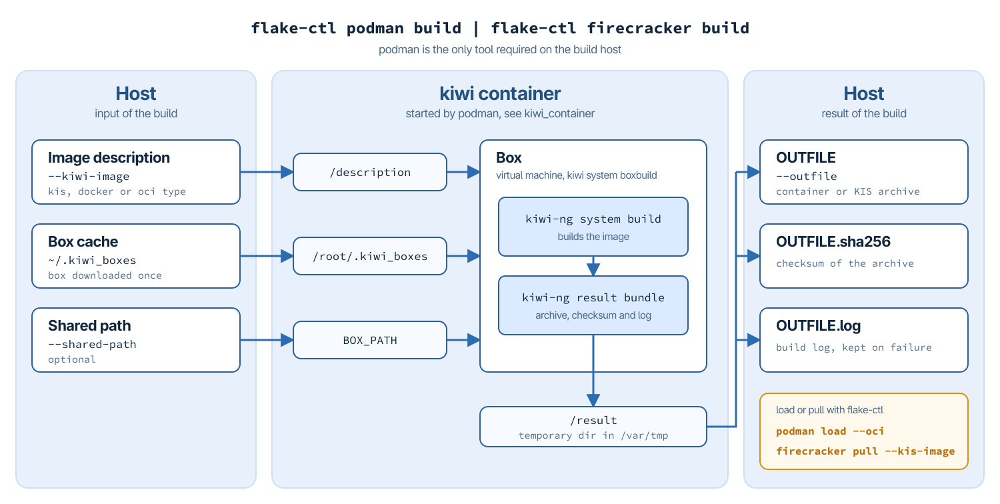

.. _building-images:

=================================
How To Build Your Own App Images
=================================

.. hint:: **Abstract**

   This chapter explains how the container and VM images the flakes
   of this guide are based on are built, and how to build your own.

The container and VM images used in this guide are built with
`KIWI <https://github.com/OSInside/kiwi>`__. Every image is described
by a KIWI image description, and the descriptions for all images used
in this guide are part of the appstore in the Flake Pilot repository:

* https://github.com/OSInside/flake-pilot/tree/main/appstore/podman
  for container images, published at
  https://gallery.ecr.aws/b9k1j9y6?page=1

* https://github.com/OSInside/flake-pilot/tree/main/appstore/firecracker
  for VM images, published at https://ddrasqgvrmpt8.cloudfront.net

They can be used as they are, or as a starting point for your own
images.

KIWI is also the tool of choice for the two image types which are
specific to Flake Pilot:

* **Delta containers**, which carry only the difference to a base
  container and are used with the ``--base`` option of
  ``flake-ctl podman register``, see :ref:`building-delta-containers`
  and :ref:`container-example-delta`.

* **KIS images**, the kernel/initrd/rootfs archives pulled with
  ``flake-ctl firecracker pull --kis-image``, see :ref:`vm-apps`.

.. _building-images-commands:

Build Commands
==============

flake-ctl provides a build command for each of the two image kinds:

* ``flake-ctl podman build`` builds container images, from image
  descriptions of the KIWI ``docker`` or ``oci`` image type.

* ``flake-ctl firecracker build`` builds VM images, from image
  descriptions of the KIWI ``kis`` image type.

Both commands take the path of the image description and the name
of the file to store the resulting image archive in:

.. code-block:: bash

   flake-ctl podman build \
       --kiwi-image /path/to/image/description \
       --outfile /path/to/result

The only tool the build host requires for this is podman. KIWI and
everything else the build needs is provided by the KIWI container
and the box it starts. Nothing of it is installed on the host, and
the host does not need to run the distribution the image is built
for.

How the Build Works
-------------------

A build takes the following steps:

1. flake-ctl starts the KIWI container through podman. The image
   description, the box cache ``~/.kiwi_boxes`` and an optional
   shared path are mounted into the container, along with a
   temporary directory below ``/var/tmp`` for the result.

2. In the container, ``kiwi system boxbuild`` starts the box, a small
   virtual machine. The box is downloaded once to ``~/.kiwi_boxes``
   and reused by later builds. By default the ``tumbleweed`` box is
   used. The box runs with KVM acceleration if the host provides it.

3. In the box, KIWI builds the image and bundles the result into the
   temporary directory: the image archive, its checksum and the log
   of the build.

4. flake-ctl moves the image archive to ``OUTFILE`` and creates the
   sha256 checksum file ``OUTFILE.sha256`` next to it, which allows
   to verify the archive and makes a KIS image ready to be pulled with
   ``flake-ctl firecracker pull --kis-image``. The log of the build
   is kept as ``OUTFILE.log``, also if the build fails. The temporary
   directory is deleted.

The box and its resources are selected by the options of
``kiwi system boxbuild``, which both commands provide under the same
name, for example:

.. code-block:: bash

   flake-ctl podman build \
       --kiwi-image /path/to/image/description \
       --outfile /path/to/result \
       --box universal --box-smp-cpus 2 --box-memory 2048

The KIWI container is ``public.ecr.aws/b9k1j9y6/kiwi:latest``. Another
container can be configured with ``kiwi_container`` in
``/etc/flakes.yml``. For all options see
``man flake-ctl-podman-build`` and ``man flake-ctl-firecracker-build``.

Building Container Images
-------------------------

The container images for podman are in ``appstore/podman``, grouped
in subdirectories such as ``ai`` and ``cloudsdk``. Their descriptions
use the KIWI ``docker`` image type. ``flake-ctl podman build`` accepts
descriptions of the ``docker`` and ``oci`` image types:

.. code-block:: bash

   flake-ctl podman build \
       --kiwi-image appstore/podman/ai/claude \
       --outfile /var/tmp/claude.docker.tar

The result is a container archive, which can be loaded into the local
container storage and then registered as a flake as described in
:ref:`container-apps`:

.. code-block:: bash

   flake-ctl podman load --oci /var/tmp/claude.docker.tar

The image description is shared with the box at ``/description``.
Data outside of the description directory is only available in the
box if it is shared with the ``--shared-path`` option. The images in
``appstore/podman/cloudsdk`` for example share a repository with the
SLES release package. Their descriptions link to it through the
relative symlink ``release -> ../.sle16/release``, which resolves to
``/.sle16/release`` in the box. With ``HOST_PATH:BOX_PATH`` the
repository is shared at exactly this location:

.. code-block:: bash

   flake-ctl podman build \
       --kiwi-image appstore/podman/cloudsdk/aws \
       --outfile /var/tmp/aws.docker.tar \
       --shared-path appstore/podman/cloudsdk/.sle16:/.sle16

Without a ``BOX_PATH``, the shared path is available at the same
location in the box as on the host.

Building VM Images
------------------

The VM images for firecracker are in ``appstore/firecracker``. Their
descriptions use the KIWI ``kis`` image type, which is the type
``flake-ctl firecracker build`` expects. The result is a KIS archive
containing the rootfs, the kernel and the initrd:

.. code-block:: bash

   flake-ctl firecracker build \
       --kiwi-image appstore/firecracker/claude \
       --outfile /var/tmp/claude.kis

With the checksum file created next to it, the archive can be pulled
into the local firecracker registry right away and used as described
in :ref:`vm-apps`:

.. code-block:: bash

   flake-ctl firecracker pull --name claude \
       --kis-image /var/tmp/claude.kis

To make the image available to other hosts, publish the archive on a
web server together with its ``.sha256`` checksum file and pull it
from there by its https URL.

.. _building-delta-containers:

Delta Containers
================

A regular container image contains the complete root tree of the
application, including all the parts it shares with other
containers. A delta container contains only the files that differ
from a given base container. The base is pulled to the host once and
shared by all delta containers built against it, so every additional
application only adds its own data.

A delta container is not functional on its own. To run it, the base
container is mounted and the delta container is layered on top of it.
Flake Pilot does this in the provision step of podman flakes that
were registered with the ``--base`` option, see
:ref:`container-example-delta`. Further layers between the base and
the delta can be added with the ``--layer`` option.

In KIWI, a delta container is a container image built from a base
container with the ``delta_root`` attribute enabled:

.. code-block:: xml

   <type image="oci"
         derived_from="docker-archive:/path/to/basesystem.tar"
         delta_root="true">
       <containerconfig name="joe"/>
   </type>

The ``derived_from`` attribute sets the base container, here given as
a docker archive type. This is the base the delta container must be used
with later. The ``derived_from`` value is passed along to ``skopeo copy``
as such any skopeo supported source-image format/location can be used
to reference the base container.
A base container stored on the build host has to be made available
to the build in the box. Build the delta container with
``flake-ctl podman build`` and share the directory of the base with
the ``--shared-path`` option. It is available at the same path in the
box as on the host:

.. code-block:: bash

   flake-ctl podman build \
       --kiwi-image /path/to/joe \
       --outfile /var/tmp/joe.oci.tar \
       --shared-path /path/to

With ``delta_root="true"`` KIWI puts only the differences to that base into
the resulting image. A ``config-overlay.sh`` script, if present in
the image description, runs at the end of the build and is the last
point at which the delta root tree can be changed.

Example delta containers built against a common basesystem container,
including the ``joe`` editor used in :ref:`container-example-delta`,
can be found here:

* https://build.opensuse.org/project/show/home:marcus.schaefer:delta_containers
