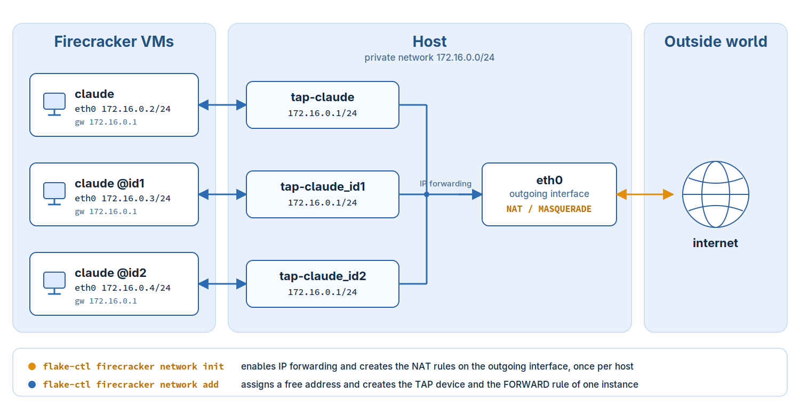

.. _firecracker-networking:

======================
Firecracker Networking
======================

.. hint:: **Abstract**

   This chapter explains how a Firecracker VM application is
   connected to the outside world, which commands create and delete
   that setup and how the result looks in the flake configuration.

Firecracker connects a virtual machine to the outside world through a
TUN/TAP device only. Such a device is a host local endpoint and
provides no connection beyond the host by itself. Routing its traffic
further is the task of the host. ``flake-pilot`` implements this as a
NAT based setup with statically assigned addresses. It is created and
deleted with the ``flake-ctl firecracker network`` commands, no
manual setup is needed.

The setup works within the following requirements:

* ``initrd_path`` must be set in the flake configuration.

* The used initrd has to provide support for
  ``systemd-(networkd, resolved)`` and must have been created by
  ``dracut`` such that the passed ``boot_args`` in the flake setup
  will become effective.

The Concept
===========

All VM applications of a host live in one private network which does
not exist outside of that host:

* Private network: ``172.16.0.0/24`` if the host allows it, see below
* Gateway, the host side of the network: the first address of that
  network, e.g ``172.16.0.1``
* Netmask: ``255.255.255.0``
* Name server: ``8.8.8.8``, or the gateway if the host runs the
  resolver of the VMs, see below
* Name of the network interface in the guest: ``eth0``

The private network is selected when the host is prepared with
``flake-ctl firecracker network init``. The preferred network is
``172.16.0.0/24``. If the host is connected to a network which
overlaps with it, the next free ``/24`` network of the private
address space is taken instead, in the order ``172.16.0.0`` to
``172.31.255.0``, ``192.168.0.0`` to ``192.168.255.0`` and
``10.0.0.0`` to ``10.255.255.0``. The networks of the host are read
from the addresses of its interfaces and from its routing table, the
TAP devices of the flakes are left out.

The selected network is recorded along with the outgoing interface
and a recorded network is kept as long as the host does not use it.
Thus all applications of a host share the same network and the
network stays the same across reboots. Only if the recorded network
collides with a network of the host, e.g because the host was
connected to it afterwards, ``init`` selects another one. The
applications then have to be connected again to receive an address of
the new network.

The other values are compiled into ``flake-ctl`` and are not
configurable. Only the address of an application is variable. It is
assigned once, when the application is connected, and is written to
its flake configuration. Therefore an application keeps its address
across calls and across reboots of the host until it is disconnected
again. The addresses of all users are allocated in one file,
``/var/lib/firecracker/network-state.yaml``, which belongs to root.
Concurrent calls are serialized by a lock on
``/var/lib/firecracker/network-state.lock``, a call which finds the
lock taken waits for it.
The address handed out is the lowest one of the private network which
is not allocated to another application, addresses of applications
which were disconnected are handed out again.

Every instance of an application has its own address and its own TAP
device. The TAP device belongs to the user who runs the instance, its
name contains the ID of that user, e.g ``tap-1000_claude``. Nobody
else can connect a VM to it. The host side of each TAP device carries
the gateway address, the guest side is configured by the kernel of the
VM from the ``ip=`` option on its commandline. No DHCP server is
involved:

The traffic of an instance takes the following path:

1. The kernel of the VM configures ``eth0`` statically from its
   commandline and routes everything to the gateway ``172.16.0.1``,
   which is the host side of the TAP device the instance is connected
   to

2. IP forwarding on the host passes the packet from the TAP device on
   to the outgoing interface. The firewall setup of the host allows
   this for traffic of the private network leaving through the
   outgoing interface only

3. The NAT rule rewrites the sender address of that traffic to the
   address of the outgoing interface. On the network of the host the
   traffic of the instance appears as if it would originate from the
   host itself

4. The answers are recognized by connection tracking and are routed
   back to the TAP device the connection came from. As all TAP
   devices carry the same gateway address, and with it the same
   route to the private network, a host route of the form
   ``172.16.0.3/32 dev tap-1000_claude`` per instance makes sure the
   packets are delivered to the device the instance is connected to

The Firewall Setup
------------------

All netfilter rules of the setup live in chains of their own,
``FLAKE_PILOT_NAT``, ``FLAKE_PILOT_FORWARD`` and ``FLAKE_PILOT_INPUT``,
which are entered by one jump rule from the builtin chains each. They
only match the traffic of the private network and of the TAP devices,
the other traffic of the host is not affected. The setup isolates the
instances:

* Traffic between two instances is dropped, also between two
  instances of the same user.

* Traffic from the outside world to an instance is dropped. Only the
  answers to connections the instance opened pass back.

* Traffic from an instance to another interface of the host than the
  outgoing interface is dropped.

* Traffic from an instance to the host itself is dropped, except for
  the NFS service of the host, which the instance may reach through
  its gateway, and the DNS and DHCP service if the host runs them for
  the VMs. These services are allowed per instance, for
  the address and the TAP device of the instance only. NFS is
  allowed in version 4, which needs no other port, see
  :ref:`firecracker-volumes`.

* IPv6 is switched off on the TAP devices, the setup is IPv4 only.

``man 8 flake-ctl-firecracker-network-init`` lists the rules.

.. note::

   Only the address in the flake configuration and its allocation are
   persistent. IP forwarding, the firewall setup and the TAP devices
   are runtime state of the host, after a reboot they have to be
   created again. An application which is configured to use a network
   does not start if its TAP device or the firewall setup of the host
   is missing. The error message names the command which creates the
   missing part.

The Commands
============

Prepare the Host
----------------

.. code-block:: bash

   flake-ctl firecracker network init

Selects the private network of the VMs, enables IP forwarding and
creates the firewall setup for the outgoing interface, the one the
traffic of the VMs leaves the host through. By default this is the
interface of the IPv4 default route of the host, another interface can
be specified with ``--outgoing-interface``, e.g
``--outgoing-interface eth0``. This is done once per host, and again
after a reboot, not once per application. Network and interface are
recorded such that the following commands use the same network and
know where to route the traffic to. If IP forwarding was switched
off, the state file records that Flake Pilot switched it on.

By default the VMs use the public name server ``8.8.8.8`` and the DNS
port of the host is closed to them. If the host runs a resolver the
VMs should use instead, e.g to resolve names of the local network,
pass ``--host-resolver``. The resolver has to answer queries on the
gateway address, e.g ``172.16.0.1``, which is not the case for most
default setups. ``dnsmasq`` can listen on it, ``systemd-resolved``
with ``DNSStubListenerExtra=172.16.0.1``. The applications connected
afterwards get the gateway as their name server and are allowed the
DNS port of the host.

Likewise the DHCP port of the host is closed to the VMs, they get a
static address and use no DHCP server. Pass ``--host-dhcp`` only if
the host runs a DHCP server for guests which are set up to request
their address by DHCP. The server has to hand out the address
allocated to the instance, the host route and the firewall rules of
the instance are bound to it.

A change of these settings takes effect for an application once it
is connected again.

Rules of former versions of Flake Pilot for single TAP devices are
deleted. The rules for all traffic former versions created, a
``MASQUERADE`` rule for the outgoing interface and a ``FORWARD`` rule
for all answers, cannot be told apart from rules created by other
means and are only reported along with the command to delete them.
TAP devices of former versions are named without the ID of the user,
they are not used anymore and stay until the next reboot or until they
are deleted by hand.

.. warning::

   Please check which tool is managing the firewall on your host and
   refer to its documentation on how to set up the NAT/postrouting
   rules. The command assumes there is no other firewall software
   active on your host and serves only as an example setup!

Connect an Application
----------------------

.. code-block:: bash

   flake-ctl firecracker network add --app $HOME/bin/claude

Allocates a free address to the application, writes the network setup
to its flake configuration, creates its TAP device for the calling
user, makes the device the gateway of the application, routes the
address of the application to it and allows the application the NFS
service of the host, its DNS service with ``--host-resolver`` and its
DHCP service with ``--host-dhcp``. The command requires the firewall setup of
``init`` to be active.

As every instance needs its own address and its own TAP device, the
command has to be called for each selector the application is called
with:

.. code-block:: bash

   flake-ctl firecracker network add --app $HOME/bin/claude --instance @id1

A system wide flake is set up by root and run by other users. Its TAP
device has to belong to the user who runs it, root names that user
with ``--user``. The address of an instance is part of the flake
configuration, the same instance can therefore only be connected for
one user. Give every user an instance of their own:

.. code-block:: bash

   sudo flake-ctl firecracker network add --app /usr/bin/claude \
       --instance @tux --user tux

Disconnect an Application
-------------------------

.. code-block:: bash

   flake-ctl firecracker network remove --app $HOME/bin/claude

Deletes the firewall rules of the application, its TAP device, the
network setup in its flake configuration and the allocation of its
address. The address becomes free for another application. Called
with ``--instance`` only the setup of that instance is deleted, with
``--user`` the setup created for that user. The host setup of the
``init`` command is shared by all applications and stays in place.

.. note::

   The application is left without an ``ip=`` option, which is the
   same state a fresh registration creates. If
   the VM should fall back to a dynamic setup, ``ip=dhcp`` has to be
   added to its ``boot_args`` by hand.

Delete the Host Setup
---------------------

.. code-block:: bash

   flake-ctl firecracker network cleanup

Deletes the TAP devices of all connected applications, the firewall
setup and switches IP forwarding off again if ``init`` switched it on.
The address allocations and the flake configurations are kept, the
host is left in the state it has after a reboot. Calling ``init`` and
``add`` again connects the applications with the addresses they had
before.

All commands change the network configuration of the host and
therefore call the required ``ip``, ``iptables``, ``sysctl`` and
``install`` commands through ``sudo``. They can be called more than
once: a device, a route, a rule or a chain which is already there is
not created twice, and one which is gone is not deleted again. After a
reboot of the host, calling ``init`` and ``add`` again restores the
setup with the same addresses.

The Result in the Flake Configuration
=====================================

The flake configuration for the registered ``claude`` app from
:ref:`vm-example-claude` can be found at:

.. code-block:: bash

   vi ~/.config/flakes/claude.yaml

Connecting the app and its instances leads to the following network
related settings. The addresses are the ones of the preferred
network, on a host which uses ``172.16.0.0/24`` already the
addresses of the selected network show up instead:

.. code-block:: yaml

   vm:
     runtime:
       firecracker:
         boot_args:
           - ip=172.16.0.2::172.16.0.1:255.255.255.0::eth0:off
           - rd.route=172.16.0.1/24::eth0
           - nameserver=8.8.8.8
         instance:
           "@id1":
             boot_args:
               - ip=172.16.0.3::172.16.0.1:255.255.255.0::eth0:off
           "@id2":
             boot_args:
               - ip=172.16.0.4::172.16.0.1:255.255.255.0::eth0:off

With this setup ``claude`` boots with the static IP 172.16.0.2,
``claude @id1`` with 172.16.0.3 and ``claude @id2`` with 172.16.0.4.
For further information about the network setup options, refer to
``man dracut.cmdline`` and look up the section about ``ip=``.

The instance settings do not replace the global ``boot_args`` but are
merged into them: an option which is also set in the ``instance``
section takes the place of the global setting of the same option,
options which are not set globally are appended. In the example above
only the ``ip=`` option is exchanged, ``rd.route=`` and
``nameserver=`` stay in effect for all instances.

.. note::

   The ``@`` character is reserved in YAML, therefore the key has to
   be quoted. For convenience the plain name without the ``@``
   prefix, e.g ``id1``, is accepted as a key as well. Run the app
   with ``PILOT_DEBUG=1`` to see whether an instance section was
   found and which kernel commandline it produced.

.. note::

   The kernel only accepts interface names shorter than 16 characters
   which do not contain ``/``, ``:`` or whitespace. Thus the TAP
   device name is built by replacing all characters outside of
   ``[A-Za-z0-9_]`` by ``_`` and by shortening names that are too
   long. A shortened name keeps the first characters of the app name
   and is made unique again by a hash suffix, e.g the app
   ``some-very-long-application-name`` uses the TAP device
   ``tap-some_bbb9de``. Run the app with ``PILOT_DEBUG=1`` to see the
   TAP device name it expects.
