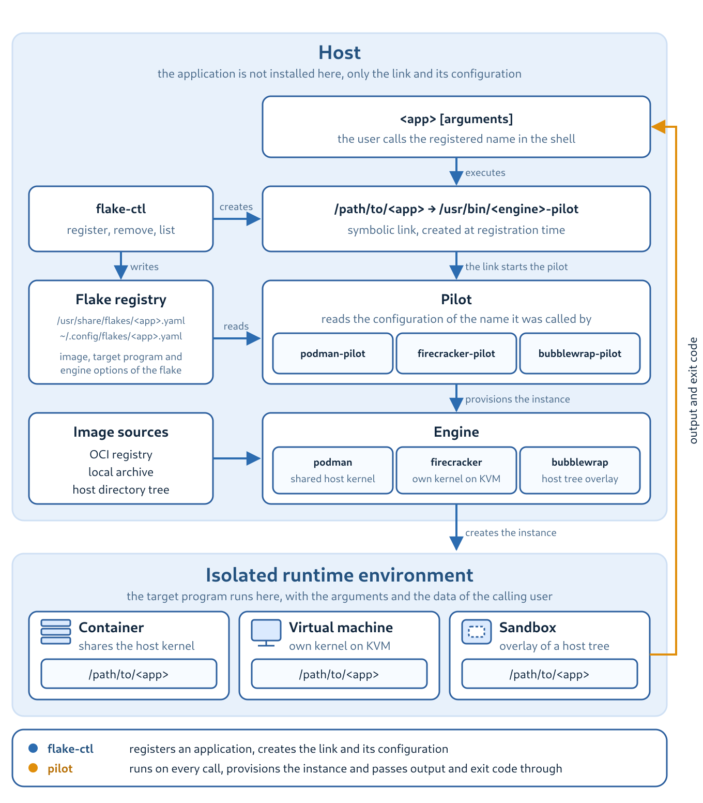

.. Flake Pilot User Guide, master document

=======================
Flake Pilot User Guide
=======================

.. rubric:: Application Isolation with a Native Feel

Flake Pilot registers, provisions and launches applications that are
not installed on your host but are provided inside a runtime
environment such as an OCI container, a Firecracker virtual machine or
a bubblewrap sandbox.
The registered application behaves like any other program on the
system: it is called by its name, it reads and writes the data you
point it to, and it returns its exit code to your shell. Everything
that is needed to run it, the image, the engine and the provisioning
of the instance, is handled behind that name.

An application registered this way is called a **flake**.

How far a flake is separated from the host depends on the engine and
on what you share with it, see :ref:`isolation-limits` and
:ref:`privileges` before you run code you do not trust.

About This Guide
================

This guide is written for administrators and developers who want to
provide isolated applications on a Linux host. It explains the
concepts behind flakes, shows how to register applications for the
``podman``, ``firecracker`` and ``bubblewrap`` engines, describes the
network setup for virtual machines and documents the layout of the
flake configuration.

The command line of each tool is documented in the manual pages
shipped with the packages, e.g ``man 8 flake-ctl`` or
``man 8 podman-pilot``. This guide references them where the details
matter.

How to Get Started
==================

Install the packages of the engines you want to use as described in
:ref:`installation`. Every engine comes with its own pilot and only
the ones you registered applications for are needed.

.. warning::

   System wide podman flakes and bubblewrap flakes with mount points
   below their tree, e.g the root of the host, need a ``sudo`` rule
   for the Flake Pilot helper. A system wide podman flake then runs
   as root for every user with the rule, with what its registration
   grants on the host. See :ref:`privileges` for which
   flakes run without the rule before granting it to anyone.

Next, prepare your user environment. Applications registered as a
normal user are placed in a directory of your choice, typically
``$HOME/bin``, which has to be part of your search path:

.. code-block:: bash

   mkdir -p ~/bin
   export PATH=$PATH:$HOME/bin

   flake-ctl init

``flake-ctl init`` creates the registry below ``$HOME/.config/flakes``
and the engine configuration that belongs to it. Called as ``root``
the registry is created in ``/usr/share/flakes`` and the registered
applications are available to everybody on the host.

With that in place a first application is one command away:

.. code-block:: bash

   flake-ctl podman register \
        --container docker.io/amazon/aws-cli --app $HOME/bin/aws --target /

   aws ec2 help

``flake-ctl list`` shows what is registered on your host. The complete
walk through, including the pitfalls of the user setup, is described
in :ref:`getting-started`.

Isolating AI Workloads With Firecracker
=======================================

AI tools are moving fast, they are rarely packaged for your
distribution, they want to read your source tree and they talk to the
network on their own. Running them in a Firecracker virtual machine
keeps them on a kernel of their own and lets you decide which part of
the host they can reach.

.. code-block:: bash

   flake-ctl firecracker pull --name claude \
       --kis-image https://ddrasqgvrmpt8.cloudfront.net/claude.x86_64-1.16.0-0.tar.xz

   flake-ctl firecracker register --vm claude \
       --app $HOME/bin/claude --target /bin/bash \
       --overlay-size 20GiB --force-vsock --resume

   claude

The application feels local, but it runs on the kernel of the VM and
cannot see the file system of the host. The write layer of the
instance lives in an overlay of its own. What the tool reaches beyond
that is up to you: :ref:`firecracker-volumes` shares a host directory
with it over NFS, which the tool then reads and writes with the rights
of the owner of that directory, and :ref:`firecracker-networking`
connects it to everything the host reaches through its outgoing
interface. :ref:`vm-apps` shows the complete example and
:ref:`isolation-limits` summarizes what remains reachable.

An Application Collection With Podman
=====================================

Cloud SDKs, vendor tools and language specific utilities are often not
packaged by your distribution, or only in a version that is too old.
Vendors do publish container images for them, and a podman flake turns
such an image into a program on your host:

.. code-block:: bash

   flake-ctl podman register \
       --container gcr.io/google.com/cloudsdktool/google-cloud-cli:stable \
       --app $HOME/bin/gcloud --target /usr/lib/google-cloud-sdk/bin/gcloud

   gcloud version

From here on ``gcloud`` is just a command. Collect the tools you need
this way and your host stays clean of the dependencies they drag in,
while each of them can be updated, pinned to a version or dropped
again on its own. :ref:`container-apps` covers the registration
options, engine options and delta containers which keep the data to
pull small.

A Throw Away Host With Bubblewrap
=================================

Some tasks want to modify the host: an installation you are not sure
about, a build that scatters files outside of its build directory, a
script from the internet you would rather watch first. The
``bubblewrap`` engine mounts a directory tree, the host root system
included, as the read only layer of an overlay:

.. code-block:: bash

   flake-ctl bubblewrap register --rootfs / \
       --app $HOME/bin/protected-shell --target /bin/bash

   protected-shell

Inside of ``protected-shell`` the host looks and behaves as usual,
packages can be installed and files can be added or overwritten, but
all of it is written to the overlay of the sandbox instead of the
host. The written data is kept in memory and is gone when the
application terminates, every call starts from the unmodified host
again. Paths you want to change on the host are bound into the
sandbox explicitly. As the host root has further mount points below
it, its overlay is mounted by the Flake Pilot helper, which needs a
``sudo`` rule, see :ref:`privileges`.
:ref:`sandbox-apps` describes the tree, the overlay and the options to
share data with the host.

The overlay protects the files of the host from changes, it does not
contain the program. A sandbox is not a security boundary, see
:ref:`isolation-limits`.

.. _isolation-limits:

Isolation and Its Limits
========================

A flake separates an application from the host as far as its engine
does, minus everything you share with it. None of the engines makes a
flake safe for hostile code on its own. Before you run code you do
not trust, check what it can reach:

``firecracker``
   The application runs on a kernel of its own and cannot see the
   file system of the host. It reaches the host through what you
   connect it to:

   * A volume, see :ref:`firecracker-volumes`. Every user of the VM
     reads and writes the exported directory with the rights of its
     owner on the host. Code in the VM can change, delete or add any
     file in it, e.g a script or a build file you later run on the
     host. Export the directory the application works on, not your
     home directory.

   * The network, see :ref:`firecracker-networking`. A connected VM
     reaches everything the host reaches through its outgoing
     interface, the local network and internal services included,
     and appears there with the address of the host. The firewall
     setup only keeps it away from other instances, from the other
     interfaces of the host and from the services of the host except
     NFS, and DNS and DHCP if the host setup was created for a
     resolver or a DHCP server on the host.

   A VM which is neither connected nor given a volume talks to the
   host only through the serial console or vsock connection of the
   pilot which starts it.

``podman``
   The application shares the kernel of the host. It is separated by
   the container runtime and reaches every path, device and network
   you hand to it with ``--opt``, e.g ``--volume`` or ``--net host``.
   Running the container with the ``krun`` runtime adds a VM, see
   :ref:`krun-runtime`.

``bubblewrap``
   Not a security boundary. The overlay keeps the tree unchanged, but
   the application shares the kernel and, unless further ``bwrap``
   options restrict it, the network and the other namespaces of the
   caller. Every path bound writable is changed for real. Use it to
   keep a host clean, not to contain a program, see
   :ref:`sandbox-apps`.

The trust you place in Flake Pilot itself is a separate question.
Some features need a ``sudo`` rule for the Flake Pilot helper, which
runs system wide podman flakes as root for every user with the rule,
and the ``/systemfiles`` script of a delta container runs on the host,
as the user who calls the flake, while it is provisioned.
:ref:`privileges` lists these features.

.. toctree::
   :hidden:
   :maxdepth: 2
   :numbered:

   introduction
   installation
   privileges
   getting_started
   container_apps
   vm_apps
   firecracker_networking
   firecracker_volumes
   sandbox_apps
   application_setup
   building_images
   troubleshooting

Resources
=========

* Source code and issue tracker:
  https://github.com/OSInside/flake-pilot

* Packages:
  https://build.opensuse.org/package/show/Virtualization:Appliances:Builder/flake-pilot

* Prebuilt app podman containers:
  https://gallery.ecr.aws/b9k1j9y6

* Prebuild app firecracker images:
  https://ddrasqgvrmpt8.cloudfront.net

* Manual pages:
  https://github.com/OSInside/flake-pilot/tree/main/doc

Feedback is very much welcome.
